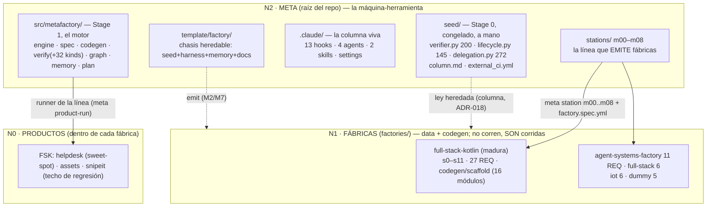
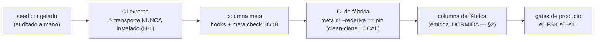
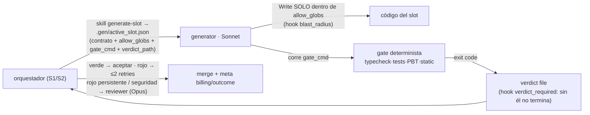

<!-- meta:doc sha=24f3b53dee5fcd84be33dac8ffec106393ae5e94 updated=2026-07-10T15:23Z -->
# ARCHITECTURE-MAP — mapa as-built del sistema (2026-07-04)

> tipo: reference (estable) · creado: 2026-07-04 (sesión Fable 5, pedido del ingeniero: «mapear la
> arquitectura a detalle para conocimiento total»). Complementa `ARCHITECTURE.md` (la FUNDACIÓN,
> 2026-06-15, pre-implementación — se conserva como fue escrita); esto es lo CONSTRUIDO, relevado del
> filesystem/CLI/journal en esa fecha. Diagramas en Mermaid (texto-primero, diffeable, renderiza en
> GitHub). Los números citados son re-derivables (`meta check`, `wc -l`, `ls`), no narrativa.
> Declara además el **modo de operación workspace** (cola COUNCIL-360 §3.8).

## §1 · El modelo: máquina-herramienta · matriz · pieza

**Meta = la máquina-herramienta; una fábrica = la MATRIZ montada en ella; el producto = la pieza**
(doctrina en `COUNCIL-360-AUDIT.md §2.5`). Nada corre como daemon: una fábrica es data+codegen —
no corre, ES corrida por el motor de meta. Hay UNA máquina (no 5 copias) para que un fix del motor
mejore las 5 fábricas al instante y el trust-chain se audite UNA vez.



## §2 · Modo de operación (declarado): WORKSPACE desde la raíz

- **Toda sesión se para sobre la raíz meta** (modelo Nx/Bazel/Rails-engine): ahí viven el motor, los
  verbos `meta`, la columna máxima (fábrica ⊊ meta, gate `least_priv`) y los hooks de cierre de turno
  (cwd-relativos — cwd persistente SIEMPRE en la raíz; subdirs solo en subshells `( cd … )`).
- Los CLAUDE.md de fábrica son **medio-vivos**: la plataforma los adjunta al leer archivos del
  subárbol. El harness `.claude/` POR-fábrica emitido está **dormido** (esqueleto de export, no
  operativo) — nadie lanza `claude` dentro de una fábrica.
- **Ruteo por SESIÓN (ADR-021, precio no seguridad):** S1 diseño = Opus corto · S2 ejecución =
  `claude --model sonnet --agent orchestrator` · S3 cierre = Opus muy corto · día-a-día
  re-verificación/pins = shell directo (0-modelo; la generación NUEVA va por slots model-nativos, ADR-023).

## §3 · El motor (Stage 1, `src/metafactory/`)

~60 módulos Python chicos (regla multi-archivo); el mayor es `cli.py` (1141 LOC, 24 verbos —
ver hallazgo H-6). Paquetes por responsabilidad:

| Paquete | Módulos clave | Responsabilidad |
| --- | --- | --- |
| `engine/` | station · sequence · runner · gate · run_context | runner GENÉRICO de líneas (dominio-agnóstico, I-2): carga estaciones-como-dato, corre en orden, respeta `requires_prev` |
| `spec/` | model · loader · validator (+design · primitives) | la espina SDD (ADR-003): `factory.spec.yml` Mitad A/B, cierre RTM (`rtm_closure`); M0 REHÚSA specs incompletas |
| `codegen/` | renderer · delegation_brain | materializa `builds` de estación (write / generate `via` script / slot LLM); inyecta el cerebro orchestrator+generate-slot en fábricas emitidas (ADR-020 C) |
| `verify/` | report · rtm · hermetic · dial · benchmark · outcome · cost_report · verdict + `checks/` (32 kinds) | el bus de veredictos (I-7) + los kinds de check REUTILIZABLES de dos lados (verde real + rojo-de-sabotaje) |
| `graph/` | model · build · python_index · ingest · affected · repomap · quality · pbt_properties · billing · pricing | grafo de proyecto content-addressed (stdlib `ast`, **solo Python** — H-7) + ledger de costos cache-aware |
| `memory/` | journal · metrics · projection · rehydrate · cadence · overlap · precompact · instrument | memoria v2 (ADR-019): journal de hechos 0-modelo, proyección a STATE, telemetría T2, observer de solapamiento |
| raíz | cli · plan · delegation · agent_roles · column_scope · docs_manifest · doc_slice · gate_wrap · toolchain_run · _seed | verbos · plan-como-data · ley de slots (re-export del seed) · vocabulario CERRADO de roles · proyección least-priv de columna · INDEX generado (ADR-009) |

**Verbos del CLI (24):** check · new · station · product-run · product · rtm · ci · pin · promote ·
verify · doc-sync · increment · checkpoint · journal · metrics · recall · rehydrate · graph · doc ·
jdk-run · billing · outcome · benchmark · dial · plan.

**`meta check` (la verdad del sustrato) = 18 gates:** compile · docs · projection · isolation ·
generality · quality · pbt · security · deferred · benchmark · dial · column_parity · least_priv ·
roles · plan · state_snapshot · state_fidelity · suite.

## §4 · La columna (Stage 0 + harness) y la cadena de confianza

Los **3 cerrojos** anti-sello-de-goma: (1) `seed/verifier.py` es el ÚNICO escritor de veredictos y
computa `passed` SOLO de exit codes reales de subprocesos; (2) `gate_recompute_ok` recomputa
`passed`+`proof_sha` desde los propios checks del proof — un `passed=true` editado a mano se detecta;
(3) el hook `Stop` (`stop_proof`) re-corre verify y bloquea el cierre de turno en rojo.

| Hook (`.claude/hooks/`) | Evento | Sombra determinista de |
| --- | --- | --- |
| proof_protect | PreToolUse | `.proof/`/ledger/rtm intocables por el modelo (cerrojo 1) |
| gate_guard | PreToolUse | no avanzar estación k sin k−1 verde (cerrojo 2) |
| stop_proof | Stop | cerrojo 3 (hoy HERMÉTICO: confía en pin verde de clean-clone si el toolchain local no re-verifica) |
| commit_guard · increment_guard | PreToolUse | trailers I-10 + todo código vive en un incremento (ADR-010) |
| blast_radius · verdict_required | PreToolUse/SubagentStop **por-agent** | el generator solo escribe en `allow_globs`; no termina sin veredicto |
| doc_stamp · session_start · mem_capture · mem_rollup · pre_compact · context_nudge | PostToolUse/SessionStart/… | sello ADR-009 · rehidratación · journal · snapshot pre-compactación |

**Agents (por ROL, vocabulario cerrado ADR-020):** orchestrator (cerebro) · generator (Sonnet,
bulk-code acotado) · verifier (Haiku, digest de UN artefacto) · reviewer (Opus, residuo irreducible).



## §5 · Flujo de producción de un producto (la línea, 0-modelo salvo slots)

```mermaid
sequenceDiagram
    participant CLI as meta product-run
    participant SPEC as spec/loader+validator
    participant RUN as engine/runner
    participant GEN as codegen (renderer · via script · slot LLM)
    participant VER as seed/verifier
    CLI->>SPEC: factory.spec.yml + stations/*.yml
    SPEC-->>CLI: línea materializada (estaciones como DATO; dial draft/harden filtra tier)
    loop cada estación (gate_guard: k−1 verde)
        RUN->>GEN: builds — write literal | generate via codegen | slot LLM acotado (ej. FSK s6 bajo contract-test)
        RUN->>VER: checks [{name, cmd}]
        VER->>VER: subprocess → exit codes REALES (no lanza = exit 127, fail-safe)
        VER-->>RUN: proof.json (passed, proof_sha) + log completo a disco (bus: veredicto ≤N líneas al contexto)
    end
    CLI->>CLI: comparar contra pinned_verdict.json (ci --rederive == pin, clon limpio)
```

**Semántica exacta del pin (importante):** `proof_sha = sha256(station + sorted[(check, exit)])` —
EXCLUYE timestamps, output y **bytes de artefactos**. «Re-deriva == pin» prueba que *desde el estado
commiteado, los mismos checks re-corren y salen igual en un clon limpio*; NO ata «estos bytes» (eso,
cuando se afirma byte-identidad, lo prueba `git diff` aparte). La fuerza del pin ES la fuerza de los
checks — coherente con la filosofía (gates = spec de correctitud), débil como provenance (H-2). El
slot LLM convive con el pin porque su salida está COMMITEADA y el rederive corre sin red desde estado
commiteado, gateado por contract-test.

## §6 · Delegación verificar-no-revisar (ADR-017/020)



Uso REAL medido (journal al 2026-07-04): 5482 station_run · 263 session_start · **15 delegation ·
0 graph_query** — la línea 0-modelo es el músculo de RE-VERIFICACIÓN (pins/checks); la GENERACIÓN nueva
es model-nativa por slots (ADR-023); el harness de delegación está EN JUICIO (COUNCIL §2.6) hasta la
corrida S2 pendiente.

## §7 · Memoria (ADR-007 → ADR-019) y datos en disco

Tres memorias single-source (M6): `docs/` = hechos del proyecto (STATE overwrite · LOG append ·
decisions inmutable · work por-incremento · reference estable, sellos ADR-009 + `INDEX.md` generado) ·
`CLAUDE.md` = reglas de la fase viva · note-store de auto-memoria = relación cross-sesión. Journal y
proyección son 0-modelo; `meta metrics --overlap` es observador.

| Store | Committed | Contenido |
| --- | --- | --- |
| `.proof/` | no (re-derivable) | proofs por estación + ledger + logs + active.json |
| `pinned_verdict.json` (por fábrica) | **sí** | el pin honesto que el rederive debe igualar |
| `.graph/` | no | grafo content-addressed incremental |
| `.gen/` | no | slot manifest activo + nudges |
| `.metamem/` | no | journal.jsonl · metrics.jsonl · precompact.json |
| `benchmarks/` · `scenarios/` · `specs/` | sí | target verificable sweet-spot · corpus · esqueletos |

## §8 · THREAT-MODEL honesto (D-7, COUNCIL-360 §5 — qué se defiende y qué explícitamente NO)

El vocabulario prestado («intocable», trusting-trust, SLSA-casero) SOBRE-AFIRMABA. La verdad operativa:

**La amenaza REAL contra la que este sistema está diseñado: DERIVA + AUTOENGAÑO del modelo.**
1. *Verde narrado sin prueba* → `seed/verifier.py` computa `passed` SOLO de exit codes; `.proof/` lo
   protege un hook; el pin exige re-derivación. Defendido con dientes.
2. *Deriva silenciosa del sustrato* → pin clon-limpio local + **segundo actor** (GitHub Actions, verde
   desde 2026-07-04, run 28717567792) + gates de dos lados. Defendido.
3. *Scope-creep / opciones sin demanda* → N/A-por-medición, benchmark techo, vocabularios CERRADOS
   (roles ADR-020, kinds D-3). Defendido por gobierno con dientes.

**Lo que este sistema NO defiende (declarado, no aspiracional):**
1. *Adversario activo con acceso al working tree*: pin, checks y estaciones son EDITABLES por el modelo
   dentro de un incremento (así se trabaja, por diseño). La defensa real es columna anti-autoengaño +
   `git diff` + ojos del ingeniero en el residuo — NO es SLSA: el pin ancla VEREDICTOS (station +
   [check,exit]), no bytes (H-2); dos árboles distintos que pasen los mismos checks dan el mismo pin.
2. *Compromiso de la plataforma* (GitHub/Actions/Anthropic): fuera del modelo; el canario de plataforma
   (Silla 10) queda en cola §3 sin fecha.
3. *Supply-chain de deps generadas*: `security_scan` es un corpus de patrones + allowlist (H-4) — reduce
   el riesgo de paquete-alucinado, no lo elimina; no hay SBOM/sigstore (YAGNI a esta escala, declarado).
4. *Semántica no cubierta por gates*: la tasa de ESCAPE es el juez E4 (mutation testing) — un número
   medido, no una promesa de cero.

**Estado declarado de superficie dormida (§2.6, congelar-o-medir):** el harness de delegación EMITIDO
por-fábrica es *esqueleto de export, no operativo* (0 usos medidos); la superficie de NAVEGACIÓN del
grafo corre bajo la regla **30-días-en-0 → archivar** (observer `graph_query` en el journal la mide;
los internals del grafo quedan: alimentan `quality`/`pbt`/`billing`).

## §9 · Cómo re-derivar este mapa (no confíes en él)

`meta check` (18/18) · `meta graph repomap` · `meta rtm --factory <slug>` · `ls src/metafactory/**` ·
`sed -n /def cmd_check/,/return/p src/metafactory/cli.py`. Si este doc contradice al filesystem, gana
el filesystem — actualizá el doc (reference estable, no inmutable).
