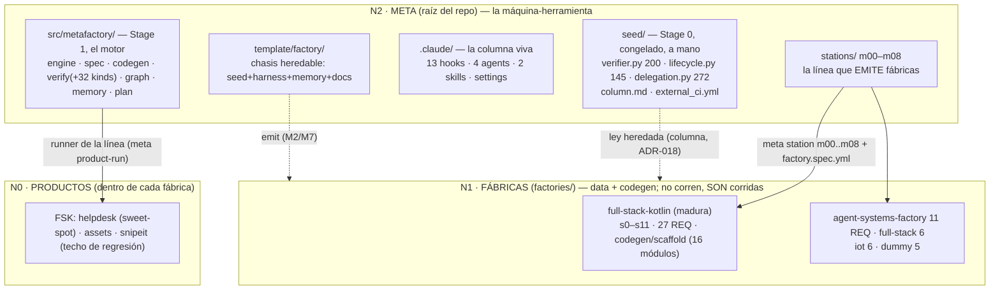
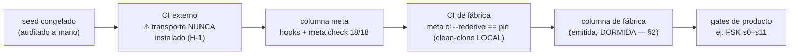
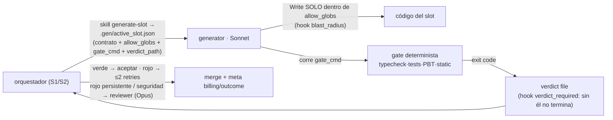

<!-- meta:doc sha=3e214094f3e519e2b69f69249258eeaf8a63238f updated=2026-07-11T15:41Z -->
# ARCHITECTURE-MAP — as-built map of the system (2026-07-04)

> type: reference (stable) · created: 2026-07-04 (sesión Fable 5, pedido del ingeniero: «mapear la
> arquitectura a detalle para conocimiento total»). Complements `ARCHITECTURE.md` (the FOUNDATION,
> 2026-06-15, pre-implementation — preserved as it was written); this is what was BUILT, surveyed from
> the filesystem/CLI/journal on that date. Diagrams in Mermaid (text-first, diffable, renders on
> GitHub). The cited numbers are re-derivable (`meta check`, `wc -l`, `ls`), not narrative.
> Also declares the **workspace operating mode** (COUNCIL-360 §3.8 queue).

## §1 · The model: machine-tool · die · workpiece

**Meta = the machine-tool; a factory = the DIE mounted on it; the product = the workpiece**
(doctrine in `COUNCIL-360-AUDIT.md §2.5`). Nothing runs as a daemon: a factory is data+codegen —
it doesn't run, it IS run by the meta engine. There is ONE machine (not 5 copies) so that an engine
fix improves all 5 factories instantly and the trust-chain is audited ONCE.



## §2 · Operating mode (declared): WORKSPACE from the root

- **Every session sits on the meta root** (Nx/Bazel/Rails-engine model): that's where the engine, the
  `meta` verbs, the maximum column (factory ⊊ meta, `least_priv` gate), and the turn-close hooks live
  (cwd-relative — the persistent cwd is ALWAYS at the root; subdirs only in `( cd … )` subshells).
- Factory CLAUDE.md files are **half-alive**: the platform attaches them when reading files in the
  subtree. The PER-factory `.claude/` harness that's emitted is **asleep** (export skeleton, not
  operational) — nobody launches `claude` inside a factory.
- **Routing per SESSION (ADR-021, price not security):** S1 design = short Opus · S2 execution =
  `claude --model sonnet --agent orchestrator` · S3 close = very short Opus · day-to-day
  re-verification/pins = direct shell (0-model; NEW generation goes through model-native slots, ADR-023).

## §3 · The engine (Stage 1, `src/metafactory/`)

~60 small Python modules (multi-file rule); the largest is `cli.py` (1141 LOC, 24 verbs —
see finding H-6). Packages by responsibility:

| Package | Key modules | Responsibility |
| --- | --- | --- |
| `engine/` | station · sequence · runner · gate · run_context | GENERIC line runner (domain-agnostic, I-2): loads stations-as-data, runs in order, respects `requires_prev` |
| `spec/` | model · loader · validator (+design · primitives) | the SDD spine (ADR-003): `factory.spec.yml` Half A/B, RTM closure (`rtm_closure`); M0 REFUSES incomplete specs |
| `codegen/` | renderer · delegation_brain | materializes station `builds` (write / generate `via` script / LLM slot); injects the orchestrator+generate-slot brain into emitted factories (ADR-020 C) |
| `verify/` | report · rtm · hermetic · dial · benchmark · outcome · cost_report · verdict + `checks/` (32 kinds) | the verdict bus (I-7) + the REUSABLE check kinds used on both sides (real green + sabotage-red) |
| `graph/` | model · build · python_index · ingest · affected · repomap · quality · pbt_properties · billing · pricing | content-addressed project graph (stdlib `ast`, **Python only** — H-7) + cache-aware cost ledger |
| `memory/` | journal · metrics · projection · rehydrate · cadence · overlap · precompact · instrument | memory v2 (ADR-019): 0-model fact journal, projection to STATE, T2 telemetry, overlap observer |
| root | cli · plan · delegation · agent_roles · column_scope · docs_manifest · doc_slice · gate_wrap · toolchain_run · _seed | verbs · plan-as-data · slot law (re-export from the seed) · CLOSED role vocabulary · least-priv column projection · generated INDEX (ADR-009) |

**CLI verbs (24):** check · new · station · product-run · product · rtm · ci · pin · promote ·
verify · doc-sync · increment · checkpoint · journal · metrics · recall · rehydrate · graph · doc ·
jdk-run · billing · outcome · benchmark · dial · plan.

**`meta check` (the substrate's ground truth) = 18 gates:** compile · docs · projection · isolation ·
generality · quality · pbt · security · deferred · benchmark · dial · column_parity · least_priv ·
roles · plan · state_snapshot · state_fidelity · suite.

## §4 · The column (Stage 0 + harness) and the trust chain

The **3 anti-rubber-stamp locks**: (1) `seed/verifier.py` is the ONLY writer of verdicts and
computes `passed` ONLY from real subprocess exit codes; (2) `gate_recompute_ok` recomputes
`passed`+`proof_sha` from the proof's own checks — a hand-edited `passed=true` is detected;
(3) the `Stop` hook (`stop_proof`) re-runs verify and blocks turn-close on red.

| Hook (`.claude/hooks/`) | Event | Deterministic shadow of |
| --- | --- | --- |
| proof_protect | PreToolUse | `.proof/`/ledger/rtm untouchable by the model (lock 1) |
| gate_guard | PreToolUse | not advancing to station k without k−1 green (lock 2) |
| stop_proof | Stop | lock 3 (today HERMETIC: trusts the clean-clone green pin if the local toolchain can't re-verify) |
| commit_guard · increment_guard | PreToolUse | I-10 trailers + all code lives inside an increment (ADR-010) |
| blast_radius · verdict_required | PreToolUse/SubagentStop **per-agent** | the generator writes ONLY inside `allow_globs`; doesn't finish without a verdict |
| doc_stamp · session_start · mem_capture · mem_rollup · pre_compact · context_nudge | PostToolUse/SessionStart/… | ADR-009 seal · rehydration · journal · pre-compaction snapshot |

**Agents (by ROLE, ADR-020 closed vocabulary):** orchestrator (brain) · generator (Sonnet,
bounded bulk-code) · verifier (Haiku, digest of ONE artifact) · reviewer (Opus, irreducible residue).



## §5 · Production flow of a product (the line, 0-model except slots)

```mermaid
sequenceDiagram
    participant CLI as meta product-run
    participant SPEC as spec/loader+validator
    participant RUN as engine/runner
    participant GEN as codegen (renderer · via script · slot LLM)
    participant VER as seed/verifier
    CLI->>SPEC: factory.spec.yml + stations/*.yml
    SPEC-->>CLI: línea materializada (estaciones como DATO; dial draft/harden filtra tier)
    loop cada estación (gate_guard: k−1 verde)
        RUN->>GEN: builds — write literal | generate via codegen | slot LLM acotado (ej. FSK s6 bajo contract-test)
        RUN->>VER: checks [{name, cmd}]
        VER->>VER: subprocess → exit codes REALES (no lanza = exit 127, fail-safe)
        VER-->>RUN: proof.json (passed, proof_sha) + log completo a disco (bus: veredicto ≤N líneas al contexto)
    end
    CLI->>CLI: comparar contra pinned_verdict.json (ci --rederive == pin, clon limpio)
```

**Exact pin semantics (important):** `proof_sha = sha256(station + sorted[(check, exit)])` —
EXCLUDES timestamps, output, and **artifact bytes**. «Re-derive == pin» proves that *from the
committed state, the same checks re-run and come out the same on a clean clone*; it does NOT
tie down «these bytes» (that, when byte-identity is claimed, is proven separately by `git diff`).
The pin's strength IS the strength of the checks — consistent with the philosophy (gates =
correctness spec), weak as provenance (H-2). The LLM slot coexists with the pin because its
output is COMMITTED and the rederive runs offline from the committed state, gated by contract-test.

## §6 · Verify-not-review delegation (ADR-017/020)



REAL measured usage (journal as of 2026-07-04): 5482 station_run · 263 session_start · **15 delegation ·
0 graph_query** — the 0-model line is the RE-VERIFICATION muscle (pins/checks); NEW generation
is model-native via slots (ADR-023); the delegation harness is UNDER TRIAL (COUNCIL §2.6) pending
the S2 run.

## §7 · Memory (ADR-007 → ADR-019) and data on disk

Three single-source memories (M6): `docs/` = project facts (STATE overwrite · LOG append ·
decisions immutable · work per-increment · reference stable, ADR-009 seals + generated `INDEX.md`) ·
`CLAUDE.md` = rules of the living phase · auto-memory note-store = cross-session relationship.
Journal and projection are 0-model; `meta metrics --overlap` is an observer.

| Store | Committed | Content |
| --- | --- | --- |
| `.proof/` | no (re-derivable) | proofs per station + ledger + logs + active.json |
| `pinned_verdict.json` (per factory) | **yes** | the honest pin that the rederive must match |
| `.graph/` | no | incremental content-addressed graph |
| `.gen/` | no | active slot manifest + nudges |
| `.metamem/` | no | journal.jsonl · metrics.jsonl · precompact.json |
| `benchmarks/` · `scenarios/` · `specs/` | yes | verifiable sweet-spot target · corpus · skeletons |

## §8 · Honest THREAT-MODEL (D-7, COUNCIL-360 §5 — what is defended and what explicitly is NOT)

The borrowed vocabulary («untouchable», trusting-trust, homemade-SLSA) OVER-ASSERTED. The operative truth:

**The REAL threat this system is designed against: DRIFT + SELF-DECEPTION of the model.**
1. *Narrated green without proof* → `seed/verifier.py` computes `passed` ONLY from exit codes; a hook
   protects `.proof/`; the pin demands re-derivation. Defended with teeth.
2. *Silent substrate drift* → local clean-clone pin + **second actor** (GitHub Actions, green
   since 2026-07-04, run 28717567792) + gates from both sides. Defended.
3. *Scope-creep / options without demand* → N/A-by-measurement, benchmark ceiling, CLOSED
   vocabularies (roles ADR-020, kinds D-3). Defended by governance with teeth.

**What this system does NOT defend against (declared, not aspirational):**
1. *Active adversary with access to the working tree*: pin, checks, and stations are EDITABLE by the
   model within an increment (that's how work happens, by design). The real defense is the
   anti-self-deception column + `git diff` + the engineer's eyes on the residue — this is NOT SLSA:
   the pin anchors VERDICTS (station + [check,exit]), not bytes (H-2); two different trees that pass
   the same checks yield the same pin.
2. *Platform compromise* (GitHub/Actions/Anthropic): out of the model's scope; the platform canary
   (Chair 10) stays queued §3 with no date.
3. *Supply chain of generated deps*: `security_scan` is a pattern corpus + allowlist (H-4) — it
   reduces the risk of a hallucinated package, doesn't eliminate it; there is no SBOM/sigstore
   (YAGNI at this scale, declared).
4. *Semantics not covered by gates*: the ESCAPE rate is judge E4 (mutation testing) — a measured
   number, not a promise of zero.

**Declared state of dormant surface (§2.6, freeze-or-measure):** the delegation harness EMITTED
per-factory is *export skeleton, not operational* (0 measured uses); the graph's NAVIGATION
surface runs under the **30-days-at-0 → archive** rule (the journal's `graph_query` observer
measures it; the graph's internals stay: they feed `quality`/`pbt`/`billing`).

## §9 · How to re-derive this map (don't trust it)

`meta check` (18/18) · `meta graph repomap` · `meta rtm --factory <slug>` · `ls src/metafactory/**` ·
`sed -n /def cmd_check/,/return/p src/metafactory/cli.py`. If this doc contradicts the filesystem,
the filesystem wins — update the doc (stable reference, not immutable).
